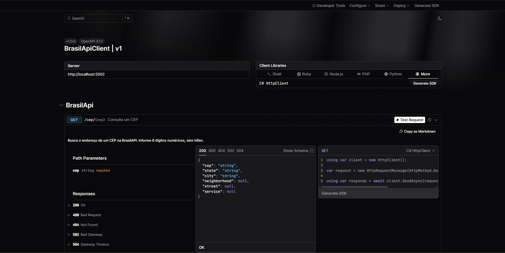
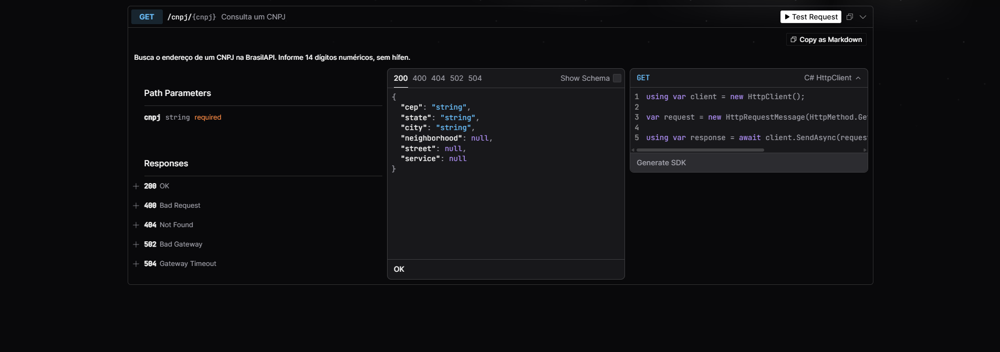

# BrasilApiClient

API REST em ASP.NET Core (.NET 10) que consome a [BrasilAPI](https://brasilapi.com.br)
para consultar CEP e CNPJ, com tratamento de erros e documentação interativa via Scalar.

## Tecnologias

- C# / .NET 10
- ASP.NET Core Web API (controllers)
- HttpClient tipado (`AddHttpClient`)
- OpenAPI + Scalar
- ProblemDetails + `IExceptionHandler`

## Como rodar

```bash
git clone https://github.com/opedrodotdev/BrasilApiClient.git
cd BrasilApiClient/BrasilApiClient
dotnet run
```

A documentação abre em `http://localhost:5002/scalar/v1`.

## Endpoints

| Método | Rota | Descrição |
|--------|------|-----------|
| GET | `/cep/{cep}` | Consulta um CEP (8 dígitos) |
| GET | `/cnpj/{cnpj}` | Consulta um CNPJ (14 dígitos) |

### Exemplo

`GET /cep/83430000`

```json
{
  "cep": "83430000",
  "state": "PR",
  "city": "Campina Grande do Sul",
  "neighborhood": null,
  "street": null,
  "service": "open-cep"
}
```

### Respostas

| Status | Quando |
|--------|--------|
| 200 | Consulta encontrada |
| 400 | CEP/CNPJ com formato inválido |
| 404 | CEP/CNPJ não encontrado |
| 502 | BrasilAPI indisponível |
| 504 | BrasilAPI demorou demais |

## Estrutura

```
BrasilApiClient/
├── Controllers/   # rotas e validação de entrada
├── Handlers/      # tratamento global de exceções
├── Models/        # classes que representam o JSON
├── Services/      # comunicação com a BrasilAPI
└── Program.cs
```



